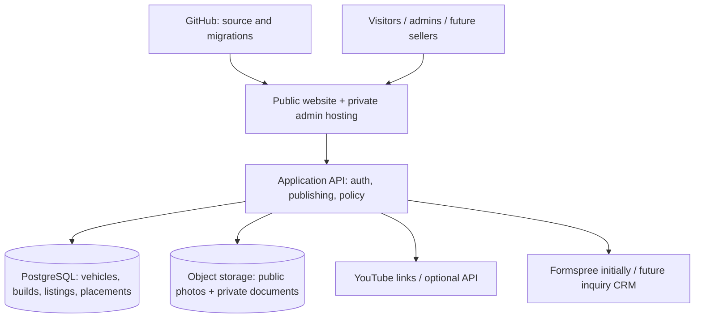

# LAKACHE AUTO — PLATFORM MASTER ARCHITECTURE
Version: 1.0 | Baseline: 2026-10-28 | Owner: Lakache Auto | Status: Living design record

> This file is the repository-maintained architecture baseline. The expanded, illustrated 12-page Word edition is titled `Lakache_Auto_Platform_Master_Architecture_v1.0.docx`. Update BOTH whenever an approved architecture change affects the design. Nothing here implies a planned service has been deployed.

## Status definitions
- **IMPLEMENTED:** Verified in inspected GitHub source.
- **REPORTED:** Known from business/project discussion, not independently verified in a vendor console.
- **PLANNED:** Preferred future design, not deployed.
- **DECISION REQUIRED:** Unresolved.

## Current system inventory
| System | Evidence | Status |
|---|---|---|
| Public website | `index.html` and other static HTML | IMPLEMENTED |
| Cars for Sale | `cars-for-sale.html` | IMPLEMENTED |
| Builds | `builds.html` | IMPLEMENTED |
| International Buyers | `international-buyers.html` | IMPLEMENTED |
| GTI, BMW, Elantra listing pages | `vehicle-listing-*.html` | IMPLEMENTED |
| Contact form | `contact.html` posts to Formspree | IMPLEMENTED |
| YouTube channel link | Contact page links to @kachautos | IMPLEMENTED |
| Hosting vendor, registrar, DNS, subscriptions | Not confirmed in provider consoles | DECISION REQUIRED |
| Private admin dashboard | No deployment verified | PLANNED |
| Supabase Auth/Postgres/Storage | Preferred provider | PLANNED |
| Cloudflare app hosting | Proposed, compatibility pending | PLANNED |
| Third-party seller marketplace | Future phase | PLANNED |

## Target architecture

## Domain model
- Organization owns records and defines access boundaries.
- Vehicle is the physical asset, distinct from sale listing.
- Build Project stores repair milestones, story, and linked episodes.
- Sale Listing stores price, seller, availability, title/mileage disclosures.
- Publication Placement stores page, priority, active flag, and schedule.
- Media Asset stores object key, category, ordering, visibility, and cover designation.
- Video Episode stores provider video ID and episode sequence.
- Inquiry and Audit Event capture buyer communication and critical changes.

## Publishing policy
GTI reference: **Homepage ON; Cars for Sale ON; Builds ON; International Buyers OFF; Ownership OFF.** This is a target configuration, not yet a deployed CMS setting. Sold vehicles may leave active sale inventory while permanent rebuild stories remain visible.

## Admin MVP
Dashboard; Vehicles; Builds; Media Library; Videos; Page Placements; Inquiries; Settings; Activity Log. Workflow: draft → edit → bulk upload → preview → validate disclosures → publish → archive/sold. Staff authentication and authorization must be verified server-side.

## Security baseline
MFA for privileged accounts; individual logins; least privilege; tenant-scoped RLS; storage policies separating public photos and private documents; server-only service secrets; upload validation and quotas; audit logs; protected deployments; monitoring; independent database AND media backups with restore tests.

## Integrations and costs
- GitHub: existing source repository; future organization transfer is proposed.
- Formspree: integrated in source; subscription and retention unknown.
- YouTube: linked channel; automatic API sync not deployed.
- Supabase: planned database/auth/media; indicative paid starting budget ~$25/month, subject to current pricing.
- Cloudflare: planned hosting candidate; compatibility and costs to verify.
- Monitoring, independent backups, email: planned vendor selection.
- Initial infrastructure planning allowance: ~$30–$60+ per month, excluding labor, domain renewal, taxes, usage overages, and major media traffic. NOT a quotation.

## Future multi-seller roadmap
Phase 0: Verify current hosting, DNS, ownership, and billing.
Phase 1: Private Lakache Auto inventory CMS and photo manager.
Phase 2: Build journals and creator/YouTube storytelling.
Phase 3: Invite-only sellers with moderation, verification, and legal review.
Phase 4: Public marketplace after compliance and commercial validation.

## Architecture decision records
- ADR-001: Retain current public site during phased admin introduction — Proposed.
- ADR-002: Separate vehicle, build project, listing, and placement — Proposed.
- ADR-003: Supabase for initial Auth/Postgres/Storage — Preferred, not provisioned.
- ADR-004: Organization-scoped model from day one — Proposed.
- ADR-005: YouTube URL links first, optional API later — Proposed.
- ADR-006: Permanent build records survive sale — Proposed.

## Change control
This is **not automatically synchronized** with deployments. Every material architectural change should include a PR updating this document, relevant diagrams, ADRs, security model, subscription register, and the illustrated Word master. Add a PR checklist item: "Architecture documentation updated, or N/A with explanation."

### Change log
| Version | Date | Summary |
|---|---|---|
| 1.0 | 2026-10-28 | Initial verified/planned baseline and target architecture |

## Open questions
Confirm registrar, DNS, current hosting provider, production deployment pipeline, GitHub organization ownership, Formspree account and plan, admin account design, image pipeline, vendor budgets, and legal scope before enabling outside sellers.
